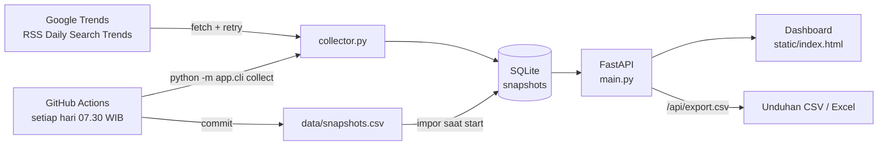
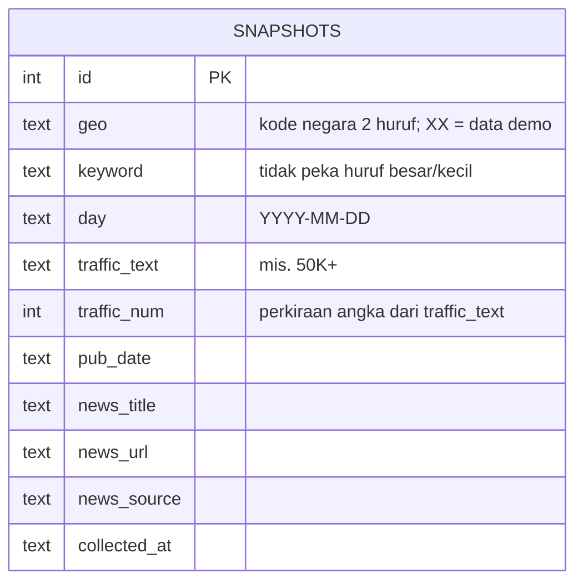
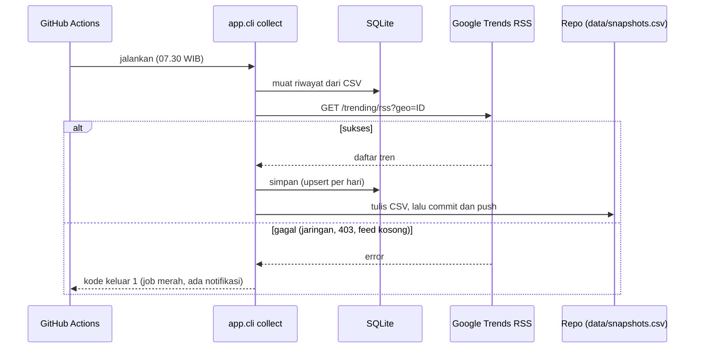

# Arsitektur TrendWatch

Diagram di bawah memakai Mermaid, jadi tampil otomatis di GitHub. Untuk laporan, buka halaman ini
di GitHub lalu ambil tangkapan layar, atau tempel kode diagram ke https://mermaid.live untuk diekspor
sebagai gambar.

## 1. Alur data

## 2. Rancangan database

Satu tabel. Satu baris mewakili satu keyword pada satu hari di satu negara
(`UNIQUE (geo, keyword, day)`), sehingga pengambilan ulang di hari yang sama
hanya memperbarui nilainya.

## 3. Urutan pengambilan harian

## 4. Aturan status keyword

Status dihitung dengan membandingkan hari terakhir yang ada datanya dengan hari sebelumnya:

| Status | Arti |
|---|---|
| `baseline` | Baru ada data satu hari, belum ada pembanding |
| `baru` | Belum pernah muncul di data sebelumnya |
| `muncul lagi` | Pernah muncul, tetapi tidak ada di hari sebelumnya |
| `naik` / `turun` / `tetap` | Perkiraan traffic dibanding hari sebelumnya |

## 5. Keputusan desain

- **Collector berantarmuka tetap.** Sumber data tidak resmi dan bisa berubah; mengganti sumber
  tidak boleh menyentuh API maupun dashboard.
- **Riwayat disimpan sebagai CSV di Git.** Server gratis sering menghapus database saat restart;
  CSV membuat riwayat tahan lama dan perubahannya bisa diperiksa.
- **Data demo dipisah (geo `XX`)** agar tidak mencemari data nyata atau CSV.
- **Kegagalan dibuat terlihat.** Pengambilan yang gagal membuat job Actions merah, bukan sukses palsu.
- **Pembatasan pengambilan** (jeda minimal per negara) agar tidak membanjiri sumber data.
