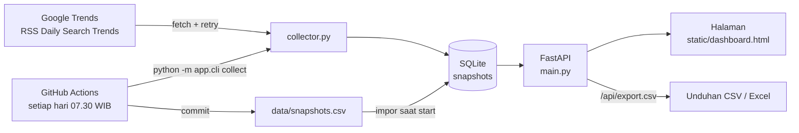
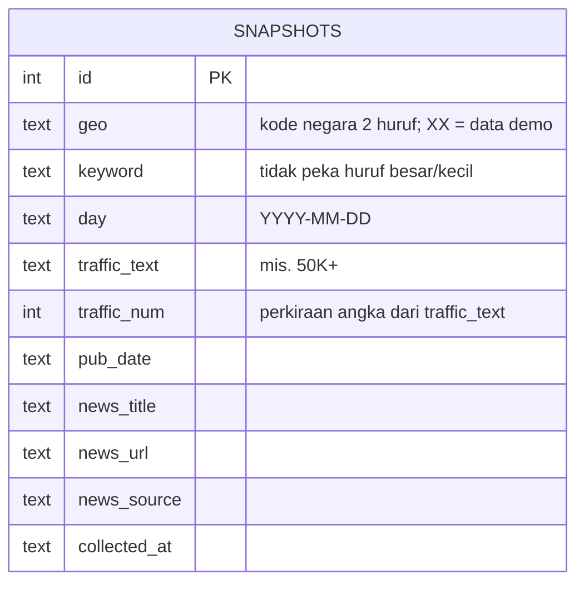
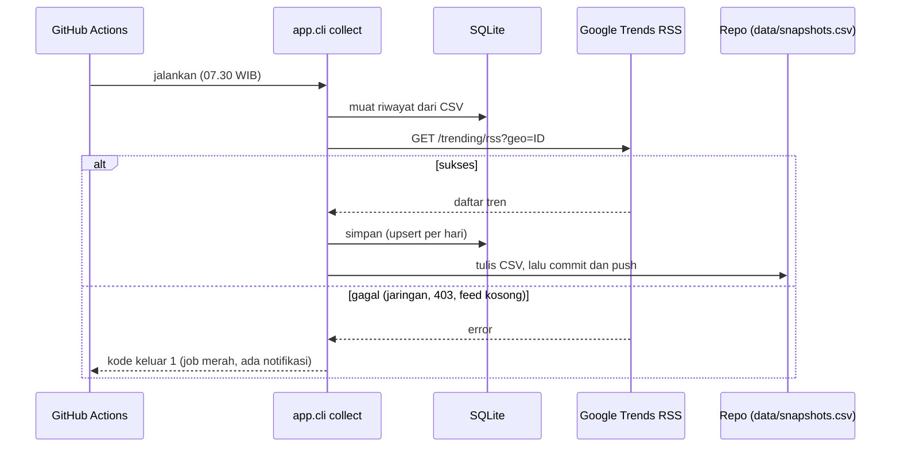
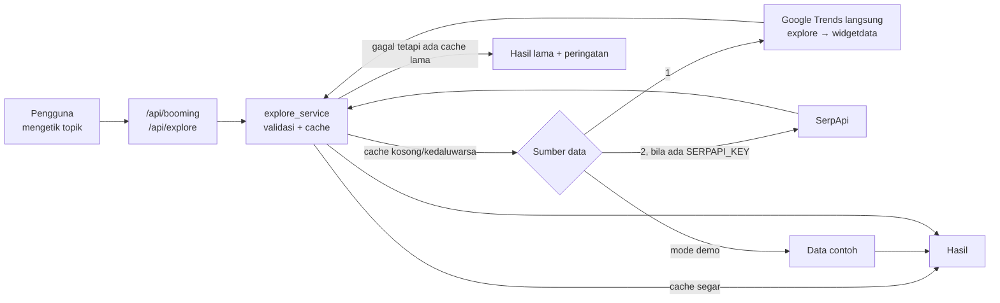
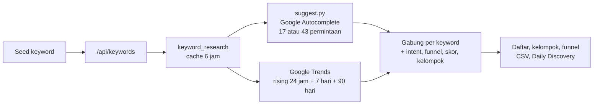

# Arsitektur TrendWatch

Diagram di bawah memakai Mermaid, jadi tampil otomatis di GitHub. Untuk laporan, buka halaman ini
di GitHub lalu ambil tangkapan layar, atau tempel kode diagram ke https://mermaid.live untuk diekspor
sebagai gambar.

## 1. Alur data

## 2. Rancangan database

Satu tabel. Satu baris mewakili satu keyword pada satu hari di satu negara
(`UNIQUE (geo, keyword, day)`), sehingga pengambilan ulang di hari yang sama
hanya memperbarui nilainya.

## 3. Urutan pengambilan harian

## 4. Aturan status keyword

Status dihitung dengan membandingkan hari terakhir yang ada datanya dengan hari sebelumnya:

| Status | Arti |
|---|---|
| `baseline` | Baru ada data satu hari, belum ada pembanding |
| `baru` | Belum pernah muncul di data sebelumnya |
| `muncul lagi` | Pernah muncul, tetapi tidak ada di hari sebelumnya |
| `naik` / `turun` / `tetap` | Perkiraan traffic dibanding hari sebelumnya |

## 5. Keputusan desain

- **Collector berantarmuka tetap.** Sumber data tidak resmi dan bisa berubah; mengganti sumber
  tidak boleh menyentuh API maupun dashboard.
- **Riwayat disimpan sebagai CSV di Git.** Server gratis sering menghapus database saat restart;
  CSV membuat riwayat tahan lama dan perubahannya bisa diperiksa.
- **Data demo dipisah (geo `XX`)** agar tidak mencemari data nyata atau CSV.
- **Kegagalan dibuat terlihat.** Pengambilan yang gagal membuat job Actions merah, bukan sukses palsu.
- **Pembatasan pengambilan** (jeda minimal per negara) agar tidak membanjiri sumber data.

## 6. Mesin Booming dan Jelajah (API, tanpa halaman)

Dua fitur ini (halamannya sudah dihapus, API tetap ada) memakai satu lapisan sumber data (`app/explore.py`) dan satu cache SQLite.

- **Booming**: satu topik → `related queries` Google. Hanya yang *naik* (rising) yang ditampilkan, diurutkan Breakout
  lebih dulu, lalu menurut persentase kenaikan; jumlahnya bisa kurang dari 10 atau nol (yang sekadar *populer* tidak
  diisikan). Tiap keyword diberi skor peluang dari 1 periode, dan klik keyword mencari turunannya dengan alur yang sama
  (`sub=true`, tidak masuk "Pencarian terakhir"). Ditambah tren harian (RSS) yang memuat topik tersebut.
- **Jelajah**: hingga 5 keyword → grafik minat dari waktu ke waktu, query terkait, dan minat per wilayah.
- Tabel tambahan: `explore_cache(cache_key, params, payload, fetched_at)`; masa berlaku Booming 1 jam,
  Jelajah 6 jam (dapat diatur lewat variabel lingkungan).

## 7. Keyword research (halaman utama `/`)

- **Skor peluang** (heuristik transparan, bukan data Google): momentum 35 + permintaan 30 + long-tail 15 + relevan 10 + multisumber 10.
- **Maksud dan funnel**: aturan kata kunci (`insight.intent5`); informasional = TOFU, komersial = MOFU, transaksional/navigasi = BOFU.
- **Kegagalan sebagian**: bila Autocomplete atau Trends gagal, hasil sisanya tetap tampil dengan catatan dan hanya di-cache 10 menit;
  bila semuanya gagal, API mengembalikan 502.
- **Saluran tambahan** (opsional, `kanal=youtube,bing`): saran pencarian YouTube (`ds=yt`) dan Bing (`osjson.aspx`), masing-masing ±17 permintaan. Gagal satu saluran tidak membatalkan hasil.
- **Turunan satu keyword** (`/api/keywords/turunan?q=cpns 2027`, dipanggil saat nama keyword diklik): Autocomplete dijalankan lagi dengan keyword itu sebagai seed (±17 permintaan, cache 6 jam), hanya saran yang memuat semua katanya yang dipakai. Hasil yang sudah ada di daftar ikut ditampilkan lebih dulu.
- **Tidak tersedia**: volume pencarian, keyword difficulty, dan data Instagram/TikTok (tidak ada sumber gratis resmi).

## 8. Platform, berita, dan riwayat keyword

- `app/platforms.py`: 15 platform (slug, nama, kata cari berita). `/platform` memilih, `/p/<slug>` menyajikan `static/dashboard.html`.
- `app/news.py`: Google Berita RSS (`news.google.com/rss/search`, `when:7d`, bahasa/negara ID), cache tabel `news_cache` (3 jam; bila Google gagal, berita tersimpan terakhir tampil dengan penanda usang). XML dengan DOCTYPE/ENTITY ditolak dan hanya tautan http(s) yang diterima.
- `app/history.py`: tabel `keyword_history` (unik per platform + keyword huruf kecil), status `dipakai` atau `tidak`, mencatat pengguna dan waktu. Endpoint: `GET/PUT/DELETE /api/platforms/<slug>/riwayat`, `GET .../riwayat/status`, `GET .../berita`.

## 9. Keyword inti per platform

- `app/core.py`: daftar tetap keyword inti per platform (`CORE`, 96 keyword). Keyword inti adalah **topik (seed)**: tiap seed diriset seperti Keyword research (saran Google/YouTube/Bing + Google Trends, mode cepat) dan hasilnya (80 keyword turunan teratas dengan kenaikan 24 jam/7 hari/90 hari, penanda "baru" dibanding riset sebelumnya) disimpan di tabel `core_research` (unik per platform + seed + negara).
- Sumber tiap seed: saran Google, **YouTube**, dan **Bing**, ditambah Google Trends: pencarian terkait (naik) dan, karena untuk topik kecil Google sering mengembalikan "belum ada pencarian terkait", **8 keyword turunan teratas dicek langsung ke Google Trends** (garis waktu harian 90 hari, satu permintaan per keyword; 24 jam = hari lengkap terakhir vs sebelumnya, 7 hari = rata-rata 7 hari vs 7 hari sebelumnya, 90 hari = 7 hari terakhir vs 7 hari pertama). Hanya kenaikan yang ditampilkan.
- Pembaruan gagal tidak menimpa data baik; berhenti setelah 2 kegagalan berturut-turut; satu pembaruan pada satu waktu (409 bila bentrok). Data lebih dari 24 jam ditandai usang.
- `app/scheduler.py`: **riset otomatis tiap hari** semua 15 platform, berurutan, di dalam aplikasi. `TRENDWATCH_CORE_SCHEDULE` (bawaan `06:00`, `off` untuk mematikan), `TRENDWATCH_TZ` (bawaan `Asia/Jakarta`). Bila aplikasi menyala setelah jam itu dan hari ini belum jalan, riset langsung dijalankan (mengejar); tanggal terakhir disimpan di `app_settings` sehingga restart tidak mengulang. **Hanya berjalan selama aplikasi menyala**; pada hosting yang tidur, jadwal tidak jalan (alternatif: `python -m app.cli core-refresh` lewat cron).
- **Langsung terisi saat dibuka**: workflow `.github/workflows/core.yml` meriset semua keyword inti tiap pukul 05:30 WIB (juga bisa dijalankan manual lewat Actions) dan menyimpan hasilnya ke `data/core_research.json`. Aplikasi memuat berkas itu saat menyala (hanya mengisi yang kosong atau lebih lama; tidak menimpa yang lebih baru), jadi dashboard langsung penuh. Bila masih ada keyword inti tanpa hasil, penjadwal di aplikasi langsung meriset tanpa menunggu jam jadwal (diulang paling cepat tiap jam).
- Estimasi lama: sekitar 30 sampai 60 detik per seed (YouTube, Bing, dan Trends per keyword ikut dicari), jadi seluruh 96 seed kira-kira 1 sampai 1,5 jam.
- Endpoint: `GET /api/platforms/<slug>/inti`, `POST /api/platforms/<slug>/inti/refresh[?demo=true]`.

- **Data Trends lengkap**: `app/serpapi_trends.py` mengambil Rising/Top lewat SerpApi (API key di `SERPAPI_KEY`, beberapa key dipisah koma) dan `app/trends_runner.py` menyimpannya ke `data/trends_web.json`; `core.listing` menggabungkannya ke panel Trends. Workflow `trends-serpapi.yml` (jadwal mingguan sedang dimatikan, jalan manual). Fitur lama lewat Chrome (tombol "Ambil data lengkap Trends") sudah dihapus.
